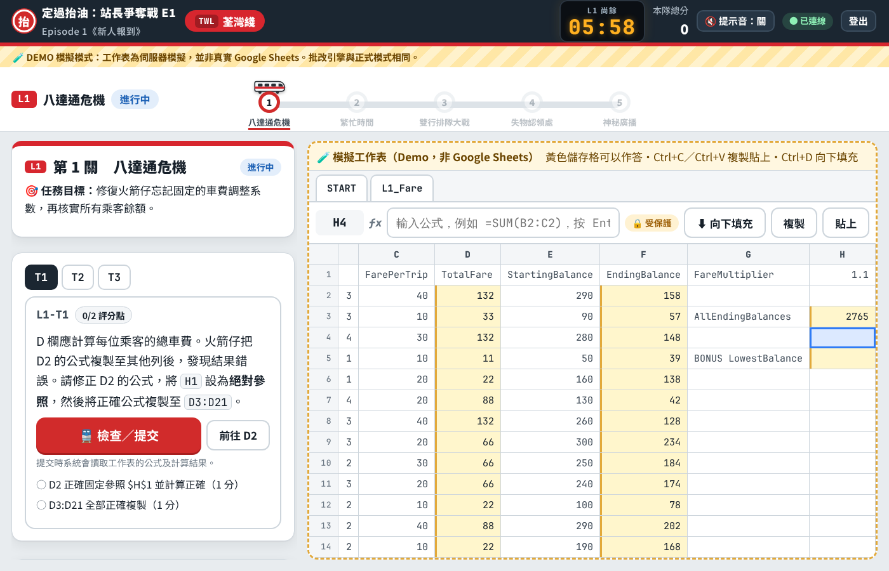
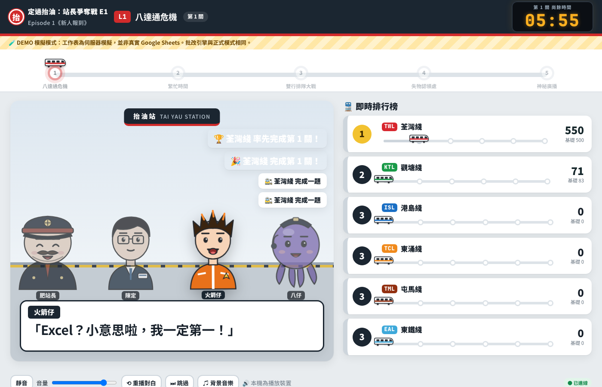
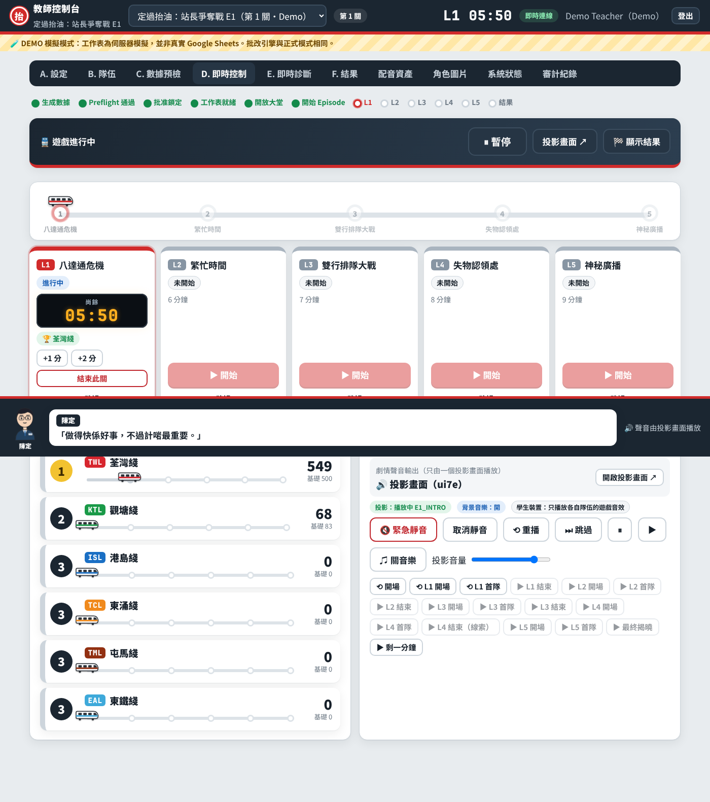

# 《定過抬油：站長爭奪戰》Episode 1《新人報到》

HKDSE ICT 中四試算表團隊競賽網頁應用程式，設計為**免費雲端託管**（Render Free + Neon Free PostgreSQL）：老師及學生在學校電腦用瀏覽器開啟網址即可，不需要安裝軟件或老師電腦一直開著。全班 6 隊（可設 4–7 隊），5 關，45 分鐘。學生在**真實的 Google Sheets** 輸入公式，網站負責中文劇情、倒數、提示、提交、**伺服器端公式批改**、計分、排行榜、教師控制及廣東話配音字幕。

> 未設定 Google 憑證之前，可以用清楚標示的 **Demo 模擬模式** 完整試玩。Demo 模式的工作表是伺服器模擬，畫面上一律標示「模擬」，**不會**聲稱已接通 Google Sheets。

## 雲端部署（正式使用）

請按 **[docs/DEPLOY_CLOUD.md](docs/DEPLOY_CLOUD.md)**：全部在 Neon 及 Render 網頁完成，不需要終端機，費用 US$0。

## 本機開發（只供開發者）

需要 Node.js 20 或以上。

```bash
npm install
```

```bash
npm start
```

1. 開啟 <http://localhost:3000>，在「Demo 試玩」輸入 PIN `2468`（啟動訊息會顯示），以 Demo 老師進入。
2. 「A. 設定」→ 建立比賽 →「C. 數據預檢」→ 生成數據 → 批准並鎖定 → 開放大堂。
3. 「B. 隊伍」→ 開啟投影畫面（另一個視窗）；記下 6 位比賽代碼。
4. 另開一個**私密／無痕視窗**，以 Demo 學生登入，輸入比賽代碼，選擇隊伍。
5. 在投影畫面按一次「🔊 啟用投影聲音」，回到老師「D. 即時控制」→ 按 **▶ 開始遊戲**（開場廣東話劇情及音樂在投影畫面自動播放）→ 開始第 1 關。學生端會出現任務及模擬工作表。

## 已實作 vs 需要外部設定

| 功能 | 狀態 |
|-|-|
| 五關題目、Blueprint、繁體中文任務／提示／Feedback | ✅ 已實作 |
| Formula Validation（AST 解析、重算、指定函數、`$` 參照、複製範圍、隱藏測試、等價公式） | ✅ 已實作（Demo 與正式模式共用） |
| Dynamic Dataset Generator（Seed 可重現、約束檢查、自動重抽、Preflight） | ✅ 已實作 |
| 計分、Leaderboard、Tie-breaker、冪等提交、審計紀錄、CSV 匯出 | ✅ 已實作 |
| 教師控制台（Setup／Teams／Preflight／Live Control／Diagnostics／Results） | ✅ 已實作 |
| 投影畫面、字幕、配音事件排隊、Spoiler Policy、播放控制 | ✅ 已實作 |
| 兩套聲音：劇情（只由指定投影畫面播放）＋ 學生遊戲音效（只在相關隊伍裝置） | ✅ 已實作並以多瀏覽器測試 |
| 雲端資料庫（PostgreSQL）、重啟後資料保留、雲端資產（錄音、角色圖片） | ✅ 已實作並以真實 PostgreSQL 測試 |
| 角色圖片上載（替換內建插圖） | ✅ 已實作（規格見 [docs/CHARACTER_ART.md](docs/CHARACTER_ART.md)） |
| 實際雲端網址 | ⚙️ 需要你建立 Neon 及 Render 免費帳戶（見 DEPLOY_CLOUD.md） |
| Demo 模擬工作表 | ✅ 已實作（清楚標示為模擬） |
| Google Sign-in | ⚙️ 已實作，**需要** `GOOGLE_CLIENT_ID`（見 [docs/SETUP_GOOGLE.md](docs/SETUP_GOOGLE.md)） |
| 真實 Google Sheets（建立、保護、分享、讀取公式＋數值） | ⚙️ 已實作並以模擬 API 測試；**需要** Google 憑證，並須在你的學校帳戶執行 `npm run google:smoke` 作端到端驗證 |
| 廣東話配音（30 句） | ✅ 已附帶，以本機開源**粵語** VITS 模型產生（不需金鑰），按「開始遊戲」後自動播放；角色各有聲線。如要更自然，可在控制台錄音或用 Azure zh-HK（見 [docs/SETUP_AUDIO_TTS.md](docs/SETUP_AUDIO_TTS.md)） |
| 角色、動畫、背景音樂、鐵路音效 | ✅ 原創 SVG 角色（眨眼、說話口型、反應）、原創合成配樂及音效 |
| Microsoft Excel 桌面版／OneDrive | ❌ 未支援（只預留 Adapter 介面） |

## 指令

| 指令 | 用途 |
|-|-|
| `npm start` | 啟動伺服器 |
| `npm test` | 驗收測試（57 項，涵蓋規格 §13 第 1–45 項；設定 `TEST_DATABASE_URL` 時另測雲端資料庫持久性） |
| `npm run test:e2e` | 瀏覽器端到端測試（需要 Playwright + Chromium） |
| `npm run demo:bots` | 六隊加速課堂模擬及壓力測試 |
| `npm run preflight:report -- SEED 6` | 命令列 Preflight 報告 |
| `npm run google:smoke` | **真實** Google Sheets 端到端測試（需要憑證） |
| `npm run tts:setup` | 下載本機粵語 TTS 模型（約 110 MB；只在需要重新合成時使用） |
| `npm run tts:generate -- --provider local --force` | 以本機粵語 TTS 重新產生配音（亦支援 `azure`／`google`） |

## 畫面

| 學生 | 投影 | 老師控制室 |
|-|-|-|
|  |  |  |

## 文件

- [docs/DEPLOY_CLOUD.md](docs/DEPLOY_CLOUD.md) — **雲端部署（網頁操作）**
- [docs/CHARACTER_ART.md](docs/CHARACTER_ART.md) — 角色圖片清單及規格
- [docs/TEACHER_GUIDE.md](docs/TEACHER_GUIDE.md) — 老師使用指南（45 分鐘課堂流程）
- [docs/SETUP_GOOGLE.md](docs/SETUP_GOOGLE.md) — Google Sign-in／Sheets／Drive 設定
- [docs/SETUP_AUDIO_TTS.md](docs/SETUP_AUDIO_TTS.md) — 廣東話配音及 TTS
- [docs/DEPLOYMENT_CHECKLIST.md](docs/DEPLOYMENT_CHECKLIST.md) — 部署檢查清單
- [docs/ARCHITECTURE.md](docs/ARCHITECTURE.md) — 架構、資料模型、API、批改流程
- [docs/TEST_RESULTS.md](docs/TEST_RESULTS.md) — 測試結果
- [docs/KNOWN_LIMITATIONS.md](docs/KNOWN_LIMITATIONS.md) — 已知限制
